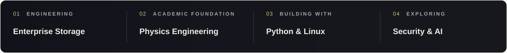

 

 

<a href="https://github.com/kgeckin?tab=repositories">PROJECTS</a>
&nbsp;&nbsp; · &nbsp;&nbsp;
<a href="https://www.linkedin.com/in/krgckn/">LINKEDIN</a>
&nbsp;&nbsp; · &nbsp;&nbsp;
<a href="https://kgeckin.github.io/">PORTFOLIO</a>

 

## 01 / Engineering perspective

### Systems make sense when their connections do.

Infrastructure engineering happens at the boundaries between systems. A storage platform depends on its hosts, network paths, virtualization layer, protection strategy, and operational requirements. The engineering is in making those dependencies work together.

At **Huawei Türkiye**, my current role is **IT Storage Engineer**, working in enterprise infrastructure delivery and system integration. This includes turning requirements and equipment lists into **Low Level Designs (LLD)**, planning rack placement and connectivity, preparing FC SAN and Ethernet integration, and supporting storage commissioning and validation in data center environments. My work spans storage and data protection platforms, including OceanStor Dorado, Pacific, and OceanProtect.

With **Physics Engineering** as my academic foundation, I approach infrastructure through constraints, failure modes, performance, and evidence. I am building toward a broader **infrastructure and cloud architecture** perspective, grounded in delivery experience rather than titles.

 

## 02 / How infrastructure comes together

<table>
<tr>
<td width="50%" valign="top">
  <h3>Design &amp; planning</h3>
  
Turning requirements into Low Level Designs (LLD): rack and power plans, controller and host port mappings, addressing, VLANs, FC zoning, and connection paths.

</td>
<td width="50%" valign="top">
  <h3>Delivery &amp; integration</h3>
  
Integrating storage with physical and virtualized hosts, SAN fabrics, Ethernet networks, and the wider data center environment, then supporting commissioning and service handover.

</td>
</tr>
<tr>
<td width="50%" valign="top">
  <h3>Validation &amp; resilience</h3>
  
Checking the intended design against real connectivity, redundancy, capacity, service continuity, and recovery requirements before a deployment is considered ready.

</td>
<td width="50%" valign="top">
  <h3>Automation &amp; analysis</h3>
  
Building scripts and practical tools that reduce repetitive tasks, clarify technical data, and make system behavior easier to inspect and explain.

</td>
</tr>
</table>

Current role: IT Storage Engineer · Practice: Infrastructure delivery and system integration · Direction: Infrastructure architecture

 

## 03 / Thinking in systems

Capacity, connectivity, workload placement, failure domains, and recovery targets influence one another. A useful design makes these dependencies visible, tests its assumptions, and remains operable after deployment.

 

## 04 / Selected work

<table>
<tr>
<td width="50%" valign="top">
  INFRASTRUCTURE SOFTWARE
  <h3><a href="https://github.com/kgeckin/W-Code2.0_FrontEnd/tree/main/HW">Inventory &amp; User Management Portal</a></h3>
  
A Flask application for infrastructure inventory, users, roles, administrative workflows and dashboard reporting.

  
<code>Python</code> <code>Flask</code> <code>Access Control</code>

  <a href="https://github.com/kgeckin/W-Code2.0_FrontEnd/tree/main/HW">View implementation ↗</a>
</td>
<td width="50%" valign="top">
  APPLIED AI
  <h3><a href="https://github.com/kgeckin/UP-School-AI-First-Developer/tree/main/Capstone">LinguaX</a></h3>
  
A prototype connecting speech recognition, translation and subtitle generation into a practical application workflow.

  
<code>Python</code> <code>Streamlit</code> <code>Whisper</code>

  <a href="https://github.com/kgeckin/UP-School-AI-First-Developer/tree/main/Capstone">View implementation ↗</a>
</td>
</tr>
<tr>
<td width="50%" valign="top">
  ANALYTICAL ENGINEERING
  <h3><a href="https://github.com/kgeckin/IBM_Applied_Data_Science_Capstone">Falcon 9 Landing Prediction</a></h3>
  
A structured study in data collection, exploratory analysis, visualization and predictive model evaluation.

  
<code>Python</code> <code>SQL</code> <code>Scikit-learn</code>

  <a href="https://github.com/kgeckin/IBM_Applied_Data_Science_Capstone">View implementation ↗</a>
</td>
<td width="50%" valign="top">
  ADDITIONAL EXPERIMENTS
  <h3><a href="https://github.com/kgeckin?tab=repositories">More from the workshop</a></h3>
  
Small applications, academic work, learning experiments and prototypes that document the path from an idea to working software.

  <a href="https://github.com/kgeckin?tab=repositories">Browse repositories ↗</a>
</td>
</tr>
</table>

Some enterprise and security engineering projects remain private due to organizational confidentiality and intellectual property requirements. The public work shown here is a selected portfolio.

 

## 05 / Working knowledge

I use **Python, Bash, SQL and Linux** for practical engineering work, alongside concepts from **virtualization, networking, SAN, storage, security, availability and recovery**. Software development and applied AI are useful tools within that work, not separate identities I need to advertise.

 

## 06 / Design questions I am exploring

How should infrastructure be connected, monitored, protected, automated and recovered? What changes when a workload moves from an on premises environment to a hybrid or cloud architecture? How can design documents and validation checks make those decisions reproducible?

These questions guide my future lab work in **virtualization, Linux administration, networking, cloud infrastructure, automation and architectural documentation**.

 

