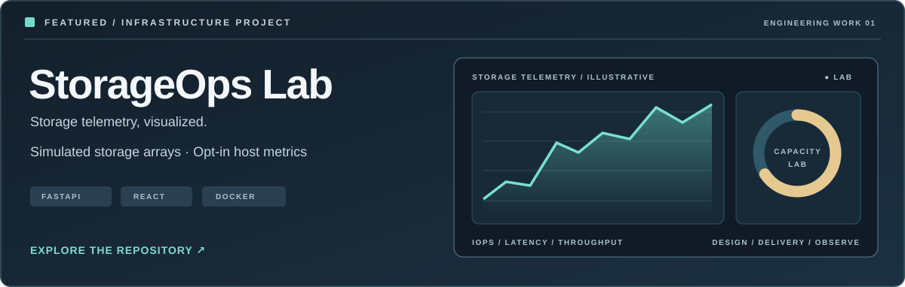
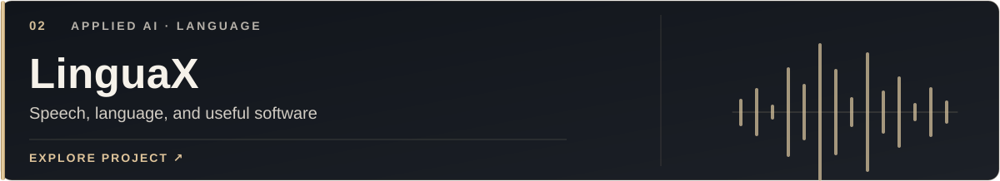
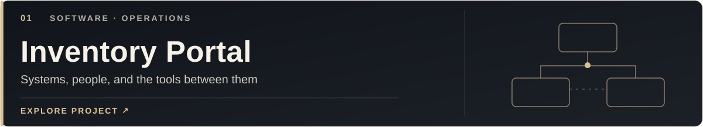
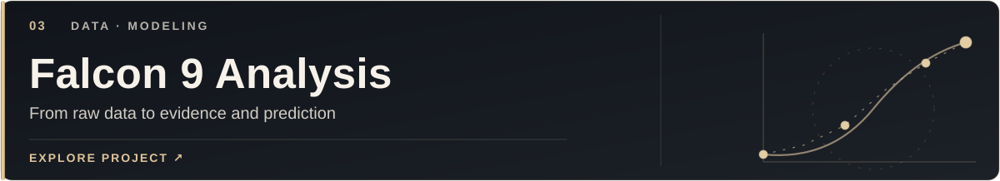
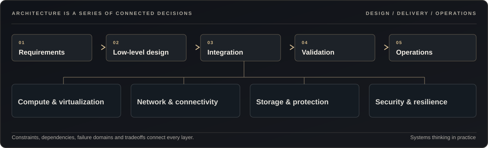
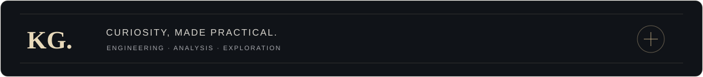

 

**IT Storage Engineer · Infrastructure / Systems / Observability**

I work where infrastructure components meet. My focus is understanding how systems are designed, deployed, connected and made reliable.

 

<a href="https://kgeckin.github.io/"><strong>Explore portfolio ↗</strong></a>
&nbsp; · &nbsp;
<a href="https://www.linkedin.com/in/krgckn/">LinkedIn</a>
&nbsp; · &nbsp;
<a href="https://github.com/kgeckin?tab=repositories">Repositories</a>

 

### Featured engineering work

StorageOps Lab explores how performance, capacity and alerts can be observed together. It combines a FastAPI simulator, React dashboard and Docker deployment with an optional, explicitly authorized host telemetry agent. The simulated storage readings are not actual storage hardware measurements.

PYTHON · FASTAPI · REACT · DOCKER · OBSERVABILITY

 
 

### Selected experiments

[View all selected projects on the portfolio](https://kgeckin.github.io/#work)

 

<strong>Engineering perspective</strong> · What connects my work

 

My current work is in enterprise storage delivery and system integration. Infrastructure naturally crosses compute, virtualization, networking, storage and operational validation.

Physics engineering shapes how I think about measurements, assumptions and failure modes. I am developing toward infrastructure and cloud architecture by building and documenting working systems.

<strong>Other explorations</strong> · Research, software and data

 

I also work with [computational physics notebooks](https://github.com/kgeckin/FIZ_437E), a [2048 web and Flask game](https://github.com/kgeckin/game2048), and [data science exercises](https://github.com/kgeckin/Miuul_MachineLearning_Bootcamp).

Only repositories intended for public sharing are linked here. Customer infrastructure, internal documents and unapproved security exercises are not portfolio demonstrations.

 

  

